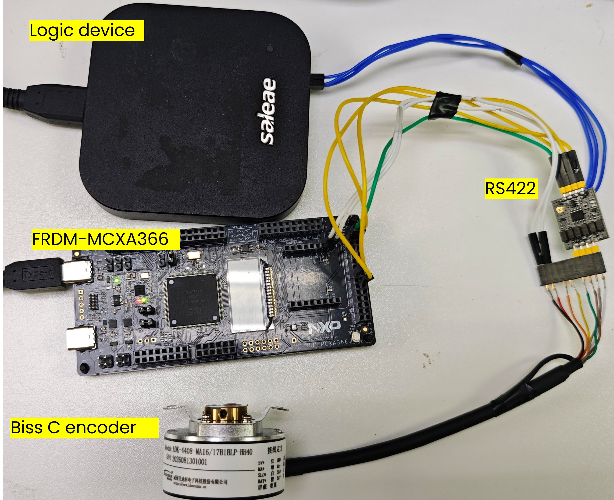
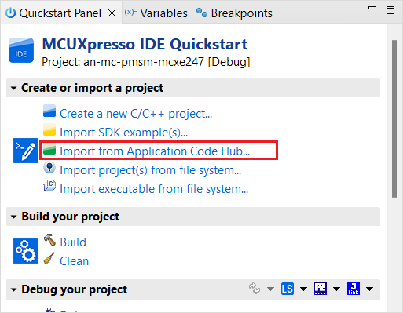
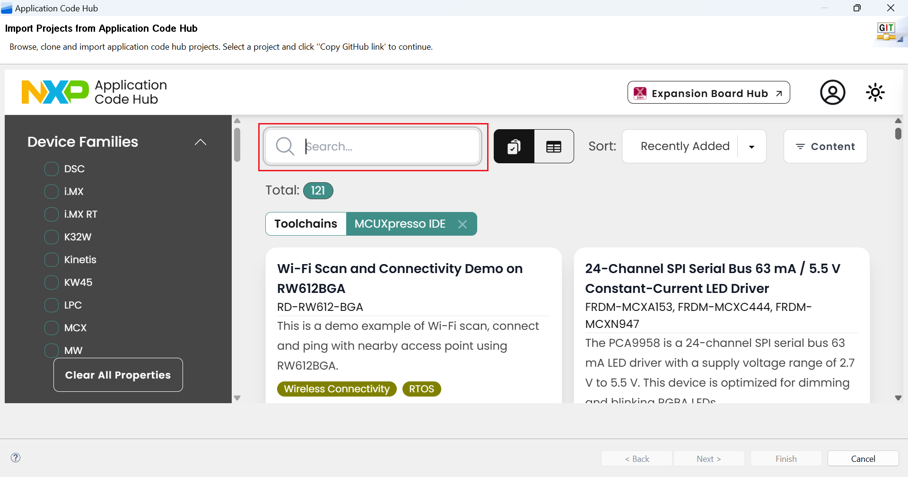
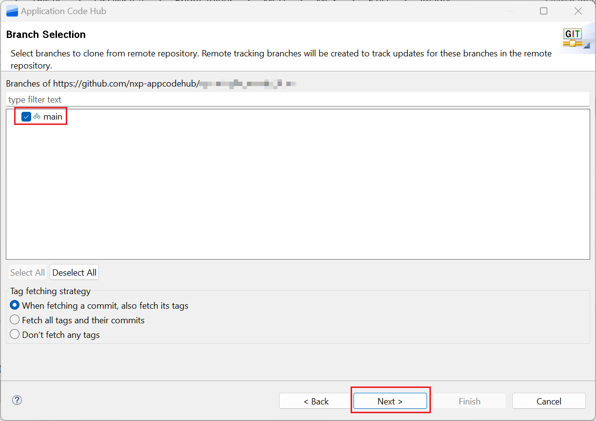

# NXP Application Code Hub

[](https://www.nxp.com)

## AN15161 BiSS-C Interface Implemented by FlexIO on MCXA366

<!-- TODO: replace ANxxxxx with the published BiSS-C application note number. -->

This software accompanies application note AN15161, which describes a FlexIO-based BiSS-C master implemented on the FRDM-MCXA366. The project generates the MA clock burst, waits for the encoder start bit (STR) on SL, captures the response in a
fixed-length receive window, decodes multi-turn and single-turn position, the CDS register-channel bit and the nE/nW status bits, and validates the received CRC6.

The default target is encoder ADK-4088-MA16/17B1BLP-BH40. The profile uses a 180 MHz FlexIO source clock, a 10 Mbps bit rate, a 16-bit multi-turn field and a 17-bit single-turn field, which gives 43 valid bits from STR through CRC6 and a 44-bit capture window across two receive shifters. Encoder profile and pin selection live in `board/app.h`. The implementation is interrupt-driven by default and also contains a polling receive path, selectable with the `DEMO_BISSC_USE_INTERRUPT` macro in `board/app.h`. Both paths were verified on hardware with a real encoder.

### Key Features

- FlexIO0 generates MA and samples SL through a two-shifter receive chain. No RS-485 direction control is needed, because BiSS-C keeps MA and SL unidirectional.
- The MA burst is gated by STR instead of a fixed clock count: MA runs from the software trigger until the receive window completes, so the master does not need to know the encoder ACK length.
- `FLEXIO_BISSC_Init` derives the receive window and the shifter count from `MT`/`ST` and the trailing sample count, so the frame length is stated in exactly one place and a mismatched profile fails at init instead of producing run-time CRC errors.
- The receive window opens on the STR rising edge and samples in the middle of each SL cell, so a correctly aligned frame always reads back `START=1`. A frame is accepted only when the CRC matches **and** `START` is set.
- CRC6 uses the standard BiSS-C parameters: polynomial `0x43`, MSB-first, final XOR `0x3F`, computed over MT + ST + nE + nW.
- Serial output reports MT, ST, the combined position `POS = MT * 2^ST_LEN + ST` with MT read as signed, plus CDS, START, ERR, WARN and the CRC result.
- A startup parser self-test checks the CRC6 parameters and the field layout on a synthetic frame, so those can be validated with no encoder attached.
- Statistics (`attempts`, `frames`, `crcErr`, `startErr`, `timeout`, `overrun`) are printed periodically, and a soak mode replaces the per-frame print with statistics for long runs.
- A frame timeout decodes the FlexIO status registers into a specific cause and reinitializes FlexIO to stop MA before the next attempt.

#### Boards: FRDM-MCXA366

#### Categories: Motor Control

#### Peripherals: FlexIO

#### Toolchains: MCUXpresso IDE

## Table of Contents

1. [Software](#step1)
2. [Hardware](#step2)
3. [Setup](#step3)
4. [Results](#step4)
5. [Support](#step5)
6. [Release Notes](#step6)

## 1. Software<a name="step1"></a>

- [MCUXpresso IDE V25.6](https://www.nxp.com/design/design-center/software/development-software/mcuxpresso-software-and-tools-/mcuxpresso-integrated-development-environment-ide:MCUXpresso-IDE) or later
- [MCUXpresso SDK 26.06.00 for FRDM-MCXA366](https://mcuxpresso.nxp.com/zh)
- MCUXpresso for Visual Studio Code: This example supports MCUXpresso for Visual Studio Code, for more information about how to use Visual Studio Code please refer [here](https://www.nxp.com/design/design-center/training/TIP-GETTING-STARTED-WITH-MCUXPRESSO-FOR-VS-CODE).

## 2. Hardware<a name="step2"></a>

- FRDM-MCXA366
- BiSS-C absolute encoder ([ADK-4088-MA16/17B1BLP-BH40](https://www.idencoder.cn), MT = 16 bits, ST = 17 bits)
- BiSS-C electrical interface meeting the encoder line-driver requirements, and an encoder power supply
- USB Type-C cable
- Personal Computer

## 3. Setup<a name="step3"></a>

### 3.1 Hardware Setup

1. Connect the BiSS-C encoder to the FRDM-MCXA366 through the electrical interface according to the pin mapping table below. The pads listed are the MCXA366 side of the interface: MA and SL reach the encoder as the differential MA and SL pairs. 
   
   | **Project<br> Signal** | **FlexIO<br> Signal** | **MCXA366<br> Pad** | **Direction** | **Purpose**                    |
   | ---------------------- | --------------------- | ------------------- | ------------- | ------------------------------ |
   | MA                     | FLEXIO0_D18           | P2_10               | Output        | 10 Mbps<br> master clock burst |
   | SL                     | FLEXIO0_D17           | P2_9                | Input         | Encoder<br> response data      |
   | GND                    | -                     | GND                 | Reference     | Common<br> logic ground        |

2. Connect the FRDM-MCXA366 to the computer via a USB Type-C cable. The hardware setup is shown below:
   
   

### 3.2 Import Project

1. Open MCUXpresso IDE, in the Quick Start Panel, choose **Import from Application Code Hub**.<br>
   
   

2. Enter the demo name in the search bar.<br><br>
   
   

3. Click **Copy GitHub link**, MCUXpresso IDE will automatically retrieve project attributes, then click **Next>**.<br><br>
   
   

4. Select **main** branch and then click **Next>**, Select the MCUXpresso project, click **Finish** button to complete import.<br><br>
   
   

### 3.3 Demo hands-on

1. Compile the project and download it to FRDM-MCXA366 board.
2. Open serial port assistant, set baud rate to 115200, connect to FRDM-MCXA366 debug UART port.
3. Press the reset button on FRDM-MCXA366 to begin operation, then observe the real-time encoder position values via UART.

## 4. Results<a name="step4"></a>

1. The serial assistant connected to the FRDM-MCXA366 serial port will display the result below. `MT` is the multi-turn revolution count, `ST` is the single-turn position within one revolution, `POS` is the combined position `MT * 131072 + ST` with `MT` read as signed, `CDS` is the register-channel bit, `START` is the frame start bit, `ERR` and `WARN` are the raw nE/nW status bits, and `CRC` reports the CRC6 check result.

```
MCUX SDK version: 2026.06.00

FlexIO BiSS-C ADK-4088-MA16/17B1BLP-BH40 demo on MCXA366
FlexIO clock: 180000000 Hz
Bit rate: 10000000 bps, MT: 16 bits, ST: 17 bits
MA: FLEXIO0_D18, SL: FLEXIO0_D17
MA gating: continuous until STR, then stopped by the RX window; SL pull: off
RX start: STR rising edge, RX edge: rising, RX window: 44 bits (1 trailing), 2 shifters
Frame wait timeout: 100 us, frame interval: 200000 us
Statistics every 20 attempts

Parser self-test: MT=4660, ST=109226, POS=610904746, CDS=1, START=1, ERR=1, WARN=0, CRC=OK, RESULT=PASS

MT=65535, ST=57054, POS=-74018, CDS=0, START=1, ERR=0, WARN=0, CRC=OK
MT=65535, ST=57054, POS=-74018, CDS=0, START=1, ERR=0, WARN=0, CRC=OK
MT=65534, ST=125432, POS=-136712, CDS=0, START=1, ERR=0, WARN=0, CRC=OK
MT=65535, ST=921, POS=-130151, CDS=0, START=1, ERR=0, WARN=0, CRC=OK
CDS byte=0x0
STATS: attempts=20, frames=20, crcErr=0, startErr=0, timeout=0, overrun=0
```

2. Frames repeat bit for bit while the shaft is stationary. When it turns, `POS` stays continuous across a single-turn rollover: the last two frames above give `-130151 - (-136712) = 6561`, exactly the number of single-turn steps through the wrap. `MT=65535` is the turn just below zero, because MT is a signed counter.

3. `CDS=0` and `CDS byte=0x0` are expected for a master that only reads position, since no CDM is sent. `ERR` and `WARN` are printed as received, without polarity interpretation; check the encoder datasheet before treating either bit as an alarm.

4. A frame that never completes prints the FlexIO status registers with a decoded cause, and FlexIO is reinitialized to stop MA before the next attempt:

```
BiSS-C frame timeout: SHIFTSTAT=0x0, SHIFTERR=0x1, TIMSTAT=0x6
  MA clocked but STR never arrived: check the SL wiring, SL pin index 17 and the encoder supply
```

   For a long run, set `DEMO_BISSC_SOAK_MODE` to `1U` in `board/app.h`: frames run back to back and only statistics are printed, while failed frames are still printed in full.

## 5. Support<a name="step5"></a>

#### Project Metadata

<!----- Boards ----->

[]()

<!----- Categories ----->

[](https://mcuxpresso.nxp.com/appcodehub?category=motor_control)

<!----- Peripherals ----->

[](https://mcuxpresso.nxp.com/appcodehub?peripheral=flexio)

<!----- Toolchains ----->

[](https://mcuxpresso.nxp.com/appcodehub?toolchain=mcux)

Questions regarding the content/correctness of this example can be entered as Issues within this GitHub repository.

> **Note**: For more general technical questions regarding NXP Microcontrollers and the difference in expected functionality, enter your questions on the [NXP Community Forum](https://community.nxp.com/)

[](https://www.youtube.com/NXP_Semiconductors)
[](https://www.linkedin.com/company/nxp-semiconductors)
[](https://www.facebook.com/nxpsemi/)
[](https://x.com/NXP)

## 6. Release Notes<a name="step6"></a>

| Version | Description / Update                    | Date                     |
|:-------:| --------------------------------------- | ------------------------:|
| 1.0     | Initial release on Application Code Hub | Sep 28<sup>th</sup> 2026 |
